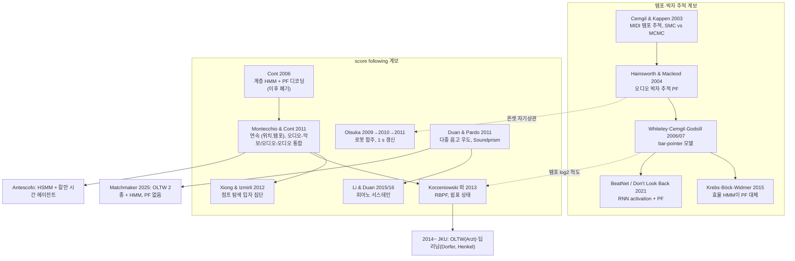

# 입자필터(Particle Filter) 기반 Score Following — 계보 심층 분석

## 도입: 13편에서 빠진 세 번째 추론기

본 아카이브의 13편은 두 갈래 추론기로 정리된다. 고전 노선은 DTW/OLTW(Arzt 2016, Lee 2022, Zeitler 2024, Bukey 2024)이고, 학습 노선은 CNN·RL·U-Net·YOLO·transformer(Dorfer, Henkel, Pillay, RUMAA)다. 그 사이에 HMM/semi-Markov(Antescofo, Nakamura)가 용어집과 관계도에 등장한다. 그런데 2010년대 초반 분야의 세 번째 추론기였던 **입자필터**(Particle Filter, Sequential Monte Carlo)는 13편 어디에도 본격 등장하지 않는다. Lee 2022 리뷰(분석 6번)에 한 줄 언급이 있을 뿐이다.

이 문서는 그 공백을 메운다. 조사 범위는 2003년 템포 추적 계보부터 2026년까지이고, 원문 PDF를 직접 읽어 확인한 수치만 "확인"으로 적었다. 못 읽은 것은 "미확인" 또는 "초록 기준"으로 남겼다. 마지막 절에서는 본 프로젝트의 첼로 추적기(cello-follower, 프레임 DTW)가 가진 다섯 가지 미해결 문제에 입자필터가 무엇을 주고 무엇을 못 주는지 논문 근거로 판정한다.

## 먼저 결론

- **이 계보는 2010~2013년에 사실상 끝났다.** 핵심 논문은 여섯 편이다. Otsuka(AAAI 2010·EURASIP 2011·ISMIR 2011), Montecchio–Cont(ICASSP 2011), Duan–Pardo(ICASSP 2011·JSTSP 2011), Xiong–Izmirli(ICMC 2012), Korzeniowski 외(ICMC 2013). 그 뒤 입자필터가 주 추론기로 쓰인 사례는 Duan 계열의 피아노 후속(Li–Duan 2015/2016) 정도다.
- **2015~2026년에 입자필터를 주 추론기로 쓴 새 score following 논문은 찾지 못했다.** 바이올린·성악, 중국어·일본어·한국어 검색어로도 마찬가지다. "없다"가 아니라 "못 찾음"이다.
- **2015년 이후 입자필터는 박자 추적(beat tracking)에서 살아남았다.** BeatNet(2021), Don't Look Back(2021)이 신경망 activation 위에 입자필터를 얹는다.
- **2026년에 논문 없이 코드로 돌아왔다.** Matchmaker v0.3.0(2026-05-25)에 오디오·MIDI 입자필터(#56)가, 2026-08-31에 Korzeniowski식 입자필터 follower(#66)가 병합됐다. 커밋 메시지에 따르면 공유 RNG 때문에 실행 순서에 따라 결과가 달라지는 비결정성 버그가 있었고 수정됐다. 아래 "버린 이유" 4번이 2026년에도 그대로 재현된 셈이다.
- **cello-follower에 가장 직접 관련된 논문은 둘이다.** Xiong & Izmirli 2012는 chroma 각도 우도에 입자 10%를 "점프 탐색용"으로 따로 유지해, 녹음에서 5박을 잘라냈을 때 일반 입자필터가 최대 4.70 s까지 무너지는 동안 0.07~0.30 s를 유지했다. Korzeniowski 외 2013은 쉼표 상태를 이산 변수로 따로 두는 Rao-Blackwellized 입자필터로 모차르트 misalign을 14.29%에서 1.92%로 줄였다.
- **세 계보가 모두 cello-follower와 같은 약점을 보고한다.** 단선율에서 같은 음이 반복되거나 오래 지속되면 길을 잃고, 한번 잃으면 복구가 어렵다(Duan–Pardo, Montecchio 학위논문, Otsuka).
- **분야가 입자필터를 버린 이유는 추론기 자체보다 관측모델이 병목이었기 때문이다.** Otsuka는 입자를 4배 늘려도 개선이 없었고, Korzeniowski–Widmer는 같은 추적기에서 템플릿만 바꿔 misalign을 12.31%에서 0.75%로 떨어뜨렸다.

## 입자필터를 한 단락으로

악보 위치를 "지금 몇 번째 박인가"라는 하나의 숫자로 추정하는 대신, 수백~수천 개의 가설(입자)을 뿌려 놓는다. 각 입자는 "위치는 여기, 템포는 이 정도"라는 작은 주장이고, 매 프레임마다 (1) 자기 템포대로 앞으로 움직이고(전이), (2) 지금 들리는 소리와 얼마나 맞는지 점수를 받고(관측 우도), (3) 점수 낮은 입자는 죽고 높은 입자는 복제된다(리샘플링). 출력은 보통 살아남은 입자들의 가중평균이다. HMM과 달리 위치·템포가 연속값이라 격자가 필요 없고, 계산량이 악보 길이와 무관하게 입자 수에만 비례한다. 대신 같은 입력에도 실행마다 결과가 조금씩 다르고, 입자가 두 무리로 갈라지면 평균이 엉뚱한 중간 지점을 가리킨다.

## 계보 한 눈에

## 논문별 카드

### Montecchio & Cont, ICASSP 2011 — 통합 SMC 정렬 (서지 확인)

"A unified approach to real time audio-to-score and audio-to-audio alignment using sequential Montecarlo inference techniques", ICASSP 2011, pp.193–196, DOI 10.1109/ICASSP.2011.5946373. ICASSP 원문은 받지 못했고, 아래는 Montecchio 2012 Padova 박사논문 2.4.2절과 4.1절(해당 논문을 바탕으로 한다고 명시)에서 확인한 것이다.

- **상태**: (위치, 템포) 2차원 연속. 악보 기준이면 위치 단위는 4분음표, 템포는 4분음표/초. 오디오 기준이면 위치는 초, 템포는 재생 속도 비율.
- **전이**: 등속 운동. 평균 = [[1, T],[0, 1]]·x, 공분산 = diag(σ1²T, σ2²T). σ1은 템포 변동, σ2는 템포를 바꾸지 않는 국소 어긋남.
- **관측**: 스펙트럼 KL 발산의 지수 감소 함수. 악보 기준이면 해당 위치 사건의 템플릿 스펙트럼과 비교.
- **추론**: SIS 입자필터. proposal은 전이분포 그대로(condensation). N_eff가 임계값 아래일 때만 리샘플링. 출력은 가중평균. 한 단계 O(Ns)로 악보 길이와 무관.
- **입자 수**: 오디오-악보 500개, 오디오-오디오 200개. 저사양 기기를 가정해 일부러 낮게. i5 2.4 GHz 단일 코어에서 약 150,000개까지 실시간.
- **결과**: 오차 = 사건 첫 검출 시점 − 공칭 온셋. 합성 클라리넷 단선율 평균 0.09~0.13 s, 최대 0.23~0.71 s. 쇼팽 마주르카 8곡×4연주(Mazurka Project 주석)에서 오디오-악보 평균 0.11~0.34 s, 최대 1.24~4.42 s. 최대 오차는 주로 곡 끝 rallentando.
- **실패 사례(첼로에 중요)**: 반복음 두 개가 연속되는 곳에서 국소 오정렬. 온셋 검출이 없기 때문이며 입자를 늘리면 완화. Op.68 n.3에서는 템포 변경 직후 같은 화음이 12번 반복되어 새 템포를 추정할 수 없었고, 선율이 다시 시작되자 복구됐다.
- **점프/반복**: 학위논문 4.1.2절. 연주자가 반복을 생략한 Op.7 n.2 녹음을 "샘플링 단계와 전이 pdf를 간단히 수정해 입자가 점프하도록" 처리. 정량 평가 없음. Manoury "Tensio"처럼 분기점이 악보에 적힌 열린 형식으로 확장 가능하다고 씀.
- **HMM과 비교**: 같은 학위논문의 HMM보다 "일관되게 우수하고, 특히 파라미터가 최적값에서 벗어날 때 강건"하다고 서술. 수치 비교표는 없음.
- **구현**: Pure Data·Max/MSP 객체 `[audioalign]`. 공개 배포 여부 미확인.
- **영향**: Xiong 2012가 평가 데이터(마주르카)와 골격을 이어받음. Korzeniowski 2013이 "표준 추적 네트워크"로 인용. Nakamura 2015 TASLP는 "미리 정해진 반복만 다루는 알고리즘"의 예로 들며 임의 반복으로 확장하면 계산량이 커진다고 비판.

### Montecchio & Cont, ISMIR 2011 — 시작점을 모르는 정렬 (서지 확인)

"Accelerating the mixing phase in studio recording productions by automatic audio alignment", ISMIR 2011, pp.627–632.

- 상태·전이·관측은 위와 같고 오디오-오디오 정렬이다.
- **핵심 1 — 시작 위치를 모르는 정렬**: 사전분포 p(x0)를 기준 녹음 전체 길이에 균일하게 깐다. 몇 번 반복하면 수렴한다.
- **핵심 2 — 리샘플링 임계값**: 실시간 추적에서는 질량이 좁게 모여 있어 임계값을 낮게 둬도 되지만, 균일 사전분포로 시작하면 "높은 임계값이 필요하고, 그렇지 않으면 관련 가설이 일찍 사라져 복구할 수 없다"고 명시.
- **입자 수**: 기준 녹음 1초당 60개. Ns = 10⁵일 때 오디오 1분을 2.29 s에 처리.
- **후처리(오프라인)**: 기울기가 1에 가까운 "관심 구간" 선택, 시간을 뒤집은 역방향 입자필터로 초반 수렴 구간 교정, 입자 기반 forward-backward 스무딩(O(Ns²)).
- **결과**: 브람스 6중주 테이크 20개 중 19개 정답(실패 1개는 최소 관심 구간 15 s보다 1초 짧은 테이크). Manoury "Tensio" 현악4중주 35개 중 26개 정렬, 잡음만 있는 14개는 모두 버림(오탐 0).

### Otsuka 외, EURASIP JASP 2011 — 로봇 합주용 입자필터 (서지 확인)

"Real-Time Audio-to-Score Alignment Using Particle Filter for Coplayer Music Robots", EURASIP J. Advances in Signal Processing 2011, Article 384651, DOI 10.1155/2011/384651. 오픈액세스. 선행판은 AAAI 2010(두 단계 동기화)과 IROS 2009(박자 추적 기반 증분 정렬, 입자필터 여부 미확인).

- **상태**: 입자마다 (악보 위치 k [박], 박 간격 b [초/박], 가중치). 4분음표 하나를 12프레임으로 분할.
- **갱신 방식**: 매 프레임이 아니라 **T = 1 s마다**, 길이 L = 2.5 s의 오디오 버퍼 전체로 갱신.
- **proposal**: 박 간격은 (64밴드 mel 압축 complex-domain 온셋 함수의 정규화 자기상관) × (악보 템포 ±θ bpm 창)에서. 위치는 오디오 온셋과 악보 온셋이 맞는 곳에서. 근처에 악보 온셋이 없으면 탐색 범위(폭 3σ_k, σ_k = 1박)에서 무작위.
- **전이**: N(b | b_{n-1}, 0.2) × N(k | k_{n-1} + T/b, 1).
- **관측**: 세 가중치의 곱. chroma 내적(C3~B6), 악보로 만든 하모닉 GMM 스펙트럼(배음 10개, 높이 0.2^g)과 오디오 스펙트럼의 KL 발산을 tanh로 사상(6 kHz 이하), 박 간격 자기상관.
- **추정과 리샘플링**: 상위 20% 입자 가중평균. 매 단계 다항 리샘플링.
- **확신도 지표**: 상위 2% 입자가 차지하는 가중치 비율 υ_n. 직전보다 0.08 넘게 떨어지면 "리듬 레벨"로 바꿔 위치 보고를 멈추고 템포만 냄. 0.07 넘게 오르면 재개.
- **지연**: 처리 자체에 200~300 ms. T초 앞을 예측해 출력.
- **평가**: RWC 재즈 20곡(피아노 단독~빅밴드), N = 1500, θ = 15 bpm. 20곡 중 16곡에서 Antescofo보다 평균 예측오차가 작았고 평균 절대오차 69% 감소. 곡 6~14 실패(잔향과 템포 요동).
- **입자 수 실험**: 1500 → 3000 → 6000으로 늘려도 거의 개선 없음. "오차 원인은 관측모델의 불일치."
- **점프/반복**: 처리하지 않음. "악보대로 연주된다"는 가정을 한계로 명시. 향후 과제로 "랜드마크(예: 후렴 시작)를 검출하면 그 위치에 입자를 추가해 점프"를 제안. 입자 주입을 **제안만** 한 셈이다. 주의: 검색 엔진 요약 하나가 이 논문이 "반복/생략을 처리한다"고 했는데, Nakamura 2015 초록이 섞인 오류다.

### Otsuka 외, ISMIR 2011 — LHA 관측모델 (서지 확인)

"Incremental Bayesian Audio-to-Score Alignment with Flexible Harmonic Structure Models", ISMIR 2011, pp.525–530. 골격은 위와 같고(σ_p² = 0.25, σ_b² = 0.1, T = 0.5 s, 창 1.5 s, 입자 300개), 관측모델을 latent harmonic allocation(LHA)으로 바꿔 변분 베이즈로 음 사이 혼합비를 관측에 맞춰 조정한다. RWC 재즈 20곡 중 10곡은 두 방식 모두, 3곡은 하나가 기존 KL보다 좋았다. 약점: 쉼표에서 LHA가 어떤 관측이든 벌점을 주고, 드럼이 하모닉 구조를 가리며, 오디오 1초 처리에 약 10초가 걸려 실시간이 아니다.

### Duan & Pardo, ICASSP 2011 — 2차원 상태공간 (서지 확인)

"A state space model for online polyphonic audio-score alignment", ICASSP 2011, pp.197–200, DOI 10.1109/ICASSP.2011.5946374.

- **상태**: s_n = (x_n 위치 [박], v_n 템포 [BPM]). 템포 범위는 악보 템포의 1/2~2배.
- **전이**: 위치는 x_n = x_{n-1} + l·v_{n-1}로 **결정적**으로 움직인다(l = hop). 템포는 직전 프레임에서 악보 온셋/오프셋을 지났을 때만 N(0, σ_v²) 랜덤워크(σ_v = 악보 템포의 1/4). 무작위성을 템포에만 넣어 위치가 매끄럽게 움직이게 했다. 실무 처리로 입자별 이전 템포 대신 직전 프레임의 입자 평균 템포를 써서 템포 확산을 막는다.
- **관측 1 (SF-Pitch)**: 다중 음고 우도 −C/ln p(y|θ). 스펙트럼 피크/비피크 모델이며 16개 악기 고립 화음으로 **사전학습**한 파라미터. 우도를 그대로 쓰면 위치마다 수십 자릿수씩 차이가 나서 전이모델이 무시되고 위치가 튀기 때문에 변환한다.
- **관측 2 (SF-Chroma)**: 오디오 chroma와 악보 0/1 chroma 사이 각도 θ에 N(0,1). 한쪽만 무음이면 θ = π/2, 둘 다 무음이면 θ = 0.
- **추론**: bootstrap 필터, 입자 1000개. 모든 입자를 1박에서 시작. 매 프레임 리샘플링 후 위치 0.01박, 템포 1 BPM의 가우시안 지터. 출력은 입자 평균.
- **평가**: Bach10(바이올린·클라리넷·테너색소폰·바순 4중주 합창곡 10곡). 파트 조합으로 단성 40 + 2중주 60 + 3중주 40 + 4중주 10 = 150곡. 프레임 46 ms, hop 10 ms.

| 동시 성부 수 | SF-Pitch | SF-Chroma | Scorealign(오프라인) |
|---|---|---|---|
| 1 | 88.4 ± 15.6 | 81.0 ± 19.5 | 86.5 ± 6.7 |
| 4 | 96.4 ± 3.3 | 92.8 ± 6.2 | 88.3 ± 7.2 |

align rate(250 ms 허용), 중앙값은 SF-Pitch 96.5 / SF-Chroma 93.4 / Scorealign 88.1.

- **핵심 관찰(첼로에 직결)**: 성부 수가 늘수록 오히려 잘 된다. 단성에서 반복음이 길거나 많은 곡이 이상치를 만들었다(온셋이 표현되지 않으므로). "온라인 추적기는 한번 길을 잃으면 제자리를 찾기 매우 어렵다."
- **점프 처리**: 없음.

### Duan & Pardo, Soundprism (IEEE JSTSP 2011) (서지 확인)

"Soundprism: An Online System for Score-Informed Source Separation of Music Audio", IEEE JSTSP 5(6):1205–1215, DOI 10.1109/JSTSP.2011.2159701. 위 추적기에 다중 음고 관측을 써서 실시간 악보 기반 음원 분리를 한다. 입자 100/1000/10000을 시험해 100개는 "자주 길을 잃고" 1000개면 드물어 1000개 채택. 입자는 보통 0.5박 이내에 모여 평균·MAP·중앙값 차이가 거의 없다. 추적기 고유 지연은 hop 10 ms뿐이나 분리까지 포함하면 Matlab에서 실시간보다 약 3배 느렸다. 실연주 Bach 합창곡에서는 오프라인 Scorealign보다 좋았고(AAE 2성부 0.17박 → 4성부 0.12박), 무작위 음열 합성 데이터에서는 크게 나빴다(템포 변동 0~30%에서 AR 약 45%, 50 ms 허용). Li 외 2019 TISMIR(실내악 시청각 음원 연결)이 이 추적기를 그대로 썼다.

### Li & Duan, ISMIR 2015 / TASLP 2016 — 피아노 서스테인 (서지 확인)

"Score Following for Piano Performances with Sustain-Pedal Effects", ISMIR 2015. TASLP 확장판 24(12):2425–2438, DOI 10.1109/TASLP.2016.2611938. Duan–Pardo 골격 위에 "지속음의 부분음을 빼고 새 음의 부분음만 남기는" 관측 전처리를 더했다. MAPS 합성 25곡 + 실연주 25곡, 곡마다 10회 반복 실행(입자필터는 확률적이라 실행마다 다르다). 중앙값 align rate와 분산이 개선됐으나 실연주에서는 "길을 잃은" 이상치가 오히려 늘었다. 입자필터 쪽 신규 기여는 없다. Lee 2022도 "입자필터는 Li & Duan 방법에서 부차적 역할"이라고 평가한다.

### Xiong & Izmirli, ICMC 2012 — 점프 탐색용 입자 집단 (서지 확인)

"Audio-to-Audio Alignment Using Particle Filters to Handle Small and Large Scale Performance Discrepancies", ICMC 2012, pp.539–542. 오디오-오디오 정렬이지만 "악보 정렬로 확장은 바로 가능"하다고 쓴다. 이 계보에서 **chroma 우도 + 점프 탐색 입자를 정량 평가한 유일한 논문**이다.

- **상태**: (기준 녹음 위치 s, 상대 템포 z).
- **관측**: chroma 각도 θ에 p ∝ exp(−θ²/(2d)). Duan–Pardo와 같은 형태.
- **전이**: z_n ~ N(z_{n-1}, σ_z²). 위치는 확률 a = 0.97로 s + z(정상 추적), 아니면 s + c (c ~ U(−C, C), 점프).
- **입자 주입 규칙**: 점프한 입자에 B 라벨. B가 전체의 10%를 넘으면 그 프레임에는 점프를 만들지 않음. B 입자 가중치는 1.3으로 나눔. 점프했는데 현재 추정 위치 근처에 떨어진 입자는 가중치 0(A가 이미 그 가설을 대표). **B가 75%를 넘으면 A/B 라벨을 바꾼다. 이것이 점프 확정이다.**
- **출력**: A 입자 중 평균 이상 가중치의 가중평균. 입자 1000개, 시작은 위치 0, 템포 0.5~2배 균일.
- **평가**: 쇼팽 마주르카 8곡 × 4연주의 모든 쌍.

| 조건 | 제안(점프 입자) | 일반 입자필터 |
|---|---|---|
| 원본 그대로 | 평균 0.060~0.136 s | 0.059~0.103 s |
| 5박 잘라낸 녹음 | 0.065~0.298 s | 0.101~**4.699** s |

원본에서는 점프 가설 때문에 약간 손해를 보고, 5박 생략에서는 일반 입자필터가 일부 곡에서 끝까지 뒤처졌다. 10박·15박 생략은 둘 다 나빠지지만 제안 방법이 덜 나빠졌다(그림으로만 제시).

### Korzeniowski, Krebs, Arzt, Widmer, ICMC 2013 — 쉼표와 템포의 RBPF (서지 확인)

"Tracking Rests and Tempo Changes: Improved Score Following with Particle Filters", ICMC 2013. JKU 그룹이 OLTW(Arzt)와 딥러닝(Dorfer)으로 넘어가기 직전의 마지막 입자필터 논문이다.

- **변수**: 연속 = 위치 x [박], 음 템포 m [log2 bpm], 국소 템포 l. 이산 = 온셋 존재 o ∈ {0,1}, 소리 상태 s ∈ {울림, 쉼}.
- **추론**: 이산 변수 {o, s}는 정확히 계산하고 연속 변수만 입자로 다루는 **Rao-Blackwellized 입자필터**. proposal은 전이 사전분포, N_eff 임계값으로 리샘플링. 출력은 상위 20% 입자 평균.
- **템포 모델**: 템포는 악보 온셋을 지날 때만 바뀐다(σ = 0.1). Duan보다 더 제한적. 다층 템포 확장으로 국소 템포는 이동평균, 음 템포는 좁은 가우시안 + 넓은 가우시안 혼합. log2 척도는 Cemgil 외 2001을 따름.
- **쉼표 모델**: 악보상 쉼표 위치에서 "울림 → 울림" 0.8, "울림 → 쉼" 0.2, "쉼 → 쉼" 1.0. 쉼표에서 앞 음이 남아 울리는 것을 허용. 악보상 울림 위치에서는 무조건 울림(피아노 데이터라서. 성악이라면 바꿔야 한다고 명시).
- **관측**: 하모닉 GMM 템플릿 상관(음수는 0, 쉼 상태에서는 1로 고정). 온셋은 spectral flux를 tanh 분포로. 음량은 SPL에 대해 울림 N(−30 dB), 쉼 N(−70 dB). 프레임 50 ms, FFT 4096.
- **입자 수**: 본문에 없음. 미확인.
- **평가**: 피아노(쇼팽, 모차르트 소나타 13개 악장, 라흐마니노프), 10회 반복, misalign 기준 250 ms.

| 곡군 | 확장 없음 | 쉼표 모델만 | 템포 모델만 | 둘 다 |
|---|---|---|---|---|
| 모차르트 소나타 | 14.29% | 2.41% | 39.05% | 1.92% |
| 라흐마니노프 전주곡 | 22.58% | 16.11% | 15.32% | 15.25% |

템포 모델만 넣으면 모차르트에서 오히려 크게 나빠진다. 쇼팽 Etude에서도 템포 모델이 약간 해로웠다.

- **후속**: Korzeniowski & Widmer, "Refined Spectral Template Models for Score Following", SMC 2013. 같은 RBPF 추적기에서 템플릿만 바꿔(합성음 음 템플릿 + 음 엔벨로프 가중) 라흐마니노프 misalign이 12.31% → 0.75%. 추론기가 아니라 관측이 병목이었다는 가장 깨끗한 증거다.

### Cont 2006 ICASSP — 폐기된 출발점 (서지 확인, 세부 미확인)

"Realtime audio to score alignment for polyphonic music instruments, using sparse non-negative constraints and hierarchical HMMs", ICASSP 2006, DOI 10.1109/ICASSP.2006.1661258. NMF 다중 음고 관측 + 계층 HMM이고 디코딩에 입자필터를 썼다(Cont 2013 HDR 본인 서술). Cont 자신의 평가는 "극도로 복잡하고 모델 파라미터를 다루기 어려웠다"이며 이후 Antescofo(Cont 2010 PAMI)로 넘어갔다.

### Yamamoto, Sako, Kitamura, ICASSP 2013 — 입자필터 아님 (서지 확인)

"Robust on-line algorithm for real-time audio-to-score alignment based on a delayed decision and anticipation framework", ICASSP 2013, DOI 10.1109/ICASSP.2013.6637635. Segmental CRF + 선형 동적 시스템 + delayed-decision Viterbi. 입자필터가 아니다(초록 기준). 후속 Ryry(AMT 2014)는 오류·반복·점프 대응을 내세우나 세부 미확인.

### 템포·박자 추적 입자필터 계보 (요지)

- **Cemgil & Kappen 2003** JAIR 18:45–81. 스위칭 상태공간 모델. 이산 스위치는 악보상 음 위치, 연속 은닉 변수는 템포. MIDI 온셋 입력으로 SMC와 MCMC 비교.
- **Hainsworth & Macleod 2004** EURASIP JASP. 오디오 박자 추적용 입자필터 두 가지(Rao-Blackwell 변형, 브라운 운동 템포). 초록 기준.
- **Whiteley, Cemgil, Godsill** ISMIR 2006 bar-pointer 모델, ICASSP 2007 순차 추론.
- **Krebs, Holzapfel, Cemgil, Widmer 2015** TASLP. 템포·위상 모호성의 다봉 분포를 다루는 meter 추론 입자필터. 세부 미확인.
- **Krebs, Böck, Widmer 2015 ISMIR** (원문 확인). "고정 격자 HMM이 가장 성능이 좋지만 지나치게 복잡하고, 입자필터는 빠르지만 downbeat 같은 하위 과제에서 약간 못하다." 새 이산화로 HMM을 가볍게 만들어 33개 조건 중 32개에서 원래 모델보다 나았다. **박자 추적에서 입자필터의 존재 이유(속도)를 없앤 논문.**
- **Heydari & Duan "Don't Look Back" ICASSP 2021, Heydari 외 BeatNet ISMIR 2021** (원문 확인). RNN activation 위에 입자필터. DLB는 입자 1000개(300개로도 비슷), 균일 초기화, 2배/절반 템포 탐색 입자를 섞음(입자 주입의 일종). BeatNet은 박 추적 1500 + downbeat 250 직렬. BeatNet의 "정보 게이트"는 activation이 약한 프레임에서 리샘플링을 건너뛴다. BeatNet 스스로 "SMC의 높은 계산 비용"을 한계로 적었다.
- **score following으로 넘어온 경로**: Korzeniowski 2013에 Krebs(박자 입자필터 연구자)가 공저자로 들어갔고 템포 log2 척도를 Cemgil에서 가져왔다. Otsuka의 박 간격 proposal은 온셋 자기상관이라는 박자 추적 기법 그대로이고 bar-pointer 모델을 향후 과제로 언급한다.

### Antescofo와의 관계 — 템포-위치 결합 상태공간 (Cont 2010, Cuvillier & Cont 2014)

Cont, IEEE TPAMI 32(6), 2010, DOI 10.1109/TPAMI.2009.106. Cuvillier & Cont, MLSP 2014, DOI 10.1109/MLSP.2014.6958908.

Antescofo는 위치를 이산 semi-Markov 상태로 두고, 템포는 Large 계열 위상 결합 모델을 원형 영역의 선형 칼만필터로 구현한 "시간 에이전트"가 따로 추적한다(Cont 2013 HDR). 즉 위치는 이산, 템포는 연속인 하이브리드다. 입자필터는 같은 결합분포를 둘 다 연속으로 놓고 표본으로 근사한 것이다. Cuvillier–Cont 2014는 지속시간 분포의 "시간 일관성" 조건(무한분해가능성, log-concavity)을 다루는데, 입자필터에서 "템포 노이즈를 온셋에서만 넣는다"(Duan, Korzeniowski)는 휴리스틱이 하려는 일, 즉 이산 구간과 연속 시간 해석의 정합을 HMM 쪽에서 이론으로 다룬 셈이다. 두 논문 모두 이산 상태를 정확히 계산하므로 확률적 변동과 입자 고갈 문제가 없다. 대신 연속 템포 가설을 위치와 결합해 여러 개 유지하지는 못한다(이 마지막 문장은 원문 근거가 아니라 구조에서 나온 정리다).

### 2024~2026 — 입자필터는 아니지만 구조가 같은 것

- **Tralie & Cantil, "The Concatenator", ISMIR 2024** (arXiv 2411.04366). score following이 아니라 실시간 concatenative synthesis지만 2024년의 입자필터 사례. 전이는 각 성분이 확률 p_d로 +1 전진, 아니면 N−1개 위치 중 **균일하게 점프**(p_d 0.9~0.99). P = 1000, N_eff < 0.1P일 때 stochastic universal sampling. corpus 길이와 무관한 계산량. Python 공개. 균일 점프 = 상시 입자 주입의 가장 단순한 형태다.
- **CODA (arXiv 2607.21899, 2026-07)**. 악보 이미지 기반으로 "무음 구동 break 모드"로 반복과 D.C.를 처리한다. 초록에 입자필터 언급 없음. 2026 동향 문서(18번)에서 다룬다.
- **입자필터가 아닌 것으로 확인된 논문**: Lin 외 2020 ACM MM 2중주(ODTW), Wada 외 SMC 2017 노래방(온라인 DTW), Burloiu SMC 2016(온라인 정렬 + 박자 추적), Jiang & Raphael SMC 2019(스위칭 칼만필터), Simsekli 외 2012(계층 HMM + LQ 제어, 추론 세부 미확인).

## 입자필터 vs HMM vs OLTW

| 항목 | 입자필터 (Duan / Otsuka / Montecchio / Korzeniowski) | HMM·HSMM (Antescofo, Nakamura 2015) | OLTW (Dixon, Arzt, cello-follower) |
|---|---|---|---|
| 상태공간 | 연속 (위치, 템포). 필요하면 이산 변수 추가(RBPF) | 음/사건별 이산 상태 + 지속시간 분포. 템포는 별도 에이전트 | (기준 프레임, 연주 프레임) 격자. 명시적 템포 없음 |
| 프레임당 계산량 | O(N). 악보 길이와 무관. 다만 불확실할수록 N이 커져야 함(Cont HDR). 관측 계산 O(N·L·f_max)가 지배적(Otsuka) | 상태 수 × 전이 수. 임의 점프를 단순 확장하면 O(N²) → Nakamura가 축소 | 밴드 폭에 비례 |
| 점프·반복 | 전이/proposal에 점프 항 또는 입자 주입(Montecchio 2012, Xiong 2012). Otsuka는 제안만 | 전이행렬에 명시(Pardo–Birmingham 2005, Nakamura 2015 임의 반복) | 기본적으로 불가. 다중 추적기·JumpDTW(오프라인) 별도 장치 |
| 다성 | 다중 음고 우도로 1~4성부(Duan). LHA로 악기 혼합비 적응(실시간 아님) | NMF 관측(Cont 2006) 등 | chroma/스펙트럼 거리로 그대로 |
| 학습 필요 | 추적 자체는 없음. Duan 다중 음고 모델은 고립 화음으로 사전학습 | 시스템마다 다름 | 없음 |
| 실시간 지연 | Duan: hop 10 ms, 고유 지연 없음 / Otsuka: 1 s마다 갱신, 처리 200~300 ms → 예측 출력 | 프레임 단위 | 프레임 단위 |
| 결정성 | **확률적**. 같은 입력에도 실행마다 다름 → 10회 반복 평균이 관행 | 결정적 | 결정적 |
| 불확실성 지표 | 기본 제공: 입자 분포, N_eff, 상위 입자 가중치 비율(Otsuka) | 사후확률에서 계산 가능 | 직접 없음(누적 비용만) |

## 분야가 입자필터를 버린 일곱 가지 이유 (원문 근거)

1. **개발 당사자가 미성숙하다고 판단했다.** Cont 2013 HDR: "실시간 시스템에서의 사용은 아직 미성숙하다." "불확실성이 커지면 필요한 입자 수도 늘어 불필요한 계산이 된다." "대부분 입자 중심(평균)으로 최종 디코딩하는데, 불확실한 상황에서 이 평균이 실시간 디코딩에 심각한 문제를 일으킬 수 있다." 그래서 Antescofo는 이산 HSMM + 칼만 시간 에이전트를 유지했다.
2. **병목은 추론이 아니라 관측모델이었다.** Otsuka: 입자 1500 → 6000에도 개선 없음. Korzeniowski–Widmer SMC 2013: 같은 RBPF에서 템플릿만 바꿔 misalign 12.31% → 0.75%. 추론기를 바꾸는 효과보다 관측을 고치는 효과가 훨씬 컸다.
3. **같은 상태공간을 HMM으로 효율적으로 풀 수 있게 됐다.** Krebs·Böck·Widmer 2015가 이산화를 바꿔 HMM을 싸게 만들어 입자필터의 속도 이점을 없앴다.
4. **확률적 비결정성** 때문에 재현과 평가가 번거롭다(10회 반복 평균).
5. **길을 잃은 뒤의 복구가 안 됐다.** Duan: "한번 잃으면 제자리를 찾기 매우 어렵다." Otsuka: 스위칭 장치도 "파트를 잃으면 도움이 덜 된다." 점프 탐색 입자(Xiong)나 랜드마크 주입(Otsuka 제안)이 해결책이었지만 앞의 것은 ICMC 단편 한 편, 뒤의 것은 제안에 그쳤다.
6. **벤치마크에 거의 등장하지 않았다.** MIREX 2010~2020에 상태공간 제출은 Duan 2010 하나(49.11%), 상위권은 모두 DTW(Lee 2022, 2차 인용). Matchmaker 2025 논문(분석 10번)도 OLTW 두 종과 HMM만 비교했다. 입자필터는 2026년 5월에야 라이브러리에 들어갔고, 리더보드(matchmaker_benchmark)에는 아직 어떤 방법의 점수도 올라 있지 않다(18번 문서).
7. **2016년 이후 관심이 악보 이미지·딥러닝으로 옮겨갔다**(Lee 2022, 본 아카이브 분석 2~5번).

## cello-follower 다섯 문제에 대한 판정

전제: cello-follower는 무반주 단선율, 23 ms 프레임 chroma, 밴드 온라인 DTW(stay 벌점, ±3 s 밴드, 전이 {stay, +1, +2}), 학습 없음. 아래는 원인·선택지·근거만 제시한다. 무엇을 고칠지는 정하지 않는다.

### (a) 이탈(틀림·건너뜀) 중 추정 위치가 들썩임

- **입자필터가 주는 것**: 불확실성 지표가 기본으로 생긴다. Otsuka는 상위 2% 입자의 가중치 비율이 급락하면 위치 보고를 멈추고 템포 외삽만 냈다. 스위칭으로 누적 오차 구간의 오출력이 걸러지는 경향이 있었지만 완전히 길을 잃은 곡에는 효과가 적었다. Duan처럼 위치에는 잡음을 넣지 않고 템포에만(온셋에서만) 넣으면 위치가 구조적으로 매끄러워진다. Xiong은 점프 가설을 별도 집단(B)에 격리하고 75%를 넘을 때만 출력을 바꾼다. 히스테리시스다.
- **주지 못하는 것**: 평균 출력은 두 가설 사이 엉뚱한 위치를 낼 수 있다(Cont HDR 경고). 단선율 반복음·장음 구간에서는 입자필터도 같은 식으로 흔들린다(Duan의 단성 이상치, Montecchio의 반복음 오정렬).
- **판정**: 들썩임 자체를 없애는 것은 추론기가 아니라 **출력 정책**(확신도 게이트, 히스테리시스)의 몫이다. Otsuka·Xiong이 쓴 이 정책은 입자필터 없이도 OLTW 위에 얹을 수 있는 형태다. 이 이식 가능성은 구조에서 나온 추론이며 논문 근거는 없다.

### (b) 시작점 검출

- **근거 있음**: Montecchio & Cont ISMIR 2011이 악보 전체에 균일 사전분포를 깔고 몇 반복 뒤 수렴시켰다. DLB/BeatNet도 균일 초기화로 즉시 출력을 낸다.
- **조건**: 리샘플링 임계값을 높여야 한다(아니면 가설이 일찍 소멸). 입자 수가 기준 길이에 비례해야 한다(1초당 60개). 초반 "수렴 구간"의 흔들림은 오프라인 역방향 패스로 교정했는데 실시간에는 쓸 수 없다.
- **판정**: 다섯 문제 중 입자필터가 가장 직접적인 답을 주는 항목이다. 다만 cello-follower의 현재 해법(align.step 무장 게이트, FLAT 0.5·LOCK 2 s)과 계산 비용, 실시간 수렴 구간의 오출력을 비교한 자료는 없다.

### (c) 반복/D.C. 점프

- **근거 있음**: Montecchio 학위논문 4.1.2절(미리 정해진 반복 지점에서 입자 점프, 정량 평가 없음). Xiong 2012(임의 점프를 균일 ±C로 탐색해 5박 생략 시 평균 오차 유지). Otsuka(랜드마크 검출 시 입자 주입 제안만). Concatenator 2024(확률 1−p_d의 균일 점프).
- **한계**: Nakamura 2015는 이런 방식을 "미리 정해진 반복만 다루며 임의 반복으로 확장하면 계산량 문제"라고 평가한다. Xiong도 점프가 없는 정상 연주에서는 약간 손해를 봤다.
- **판정**: D.C.나 반복 기호처럼 목적지가 악보에 적힌 점프라면 "목적지 위치에 입자 소수 주입"은 계산이 싸고 선례가 있다. 임의 건너뜀에 대해서는 Xiong이 유일한 정량 근거다. cello-follower는 현재 MuseScore가 반복을 전개한 MIDI를 쓰므로 "악보대로 연주"에서는 점프가 필요 없고, 연주자가 반복을 **생략**할 때가 문제인데 이것이 정확히 Montecchio Op.7 n.2 사례다.

### (d) 조율·침묵 구간

- **침묵**: Korzeniowski 2013이 가장 직접적인 근거다. 울림/쉼 이산 상태를 음량 우도(−30 dB 대 −70 dB)로 판정하고 쉼 상태에서는 스펙트럼 우도를 1로 꺼버린다. 그 결과 모차르트 misalign 14.29% → 2.41%(쉼표 모델만). 핵심은 입자필터가 아니라 **"쉼 상태에서는 관측을 끈다"는 구조**다. RBPF로 이산 부분만 정확히 계산했다는 점에서 HMM이나 DTW에도 옮길 수 있다(추론). cello-follower의 "울림 쉼표 + SILENT_STAY"는 이미 같은 발상이다. Duan의 chroma 정의(한쪽만 무음이면 θ = π/2)도 침묵 처리의 한 예. Otsuka의 LHA는 쉼표에서 실패. BeatNet의 "정보 게이트"(증거가 약한 프레임에서 리샘플링 생략)는 침묵 구간에 상태를 얼리는 것과 같은 발상이다.
- **조율(악보 밖 소리)**: 입자필터 score following 논문 중 조율 소리를 다룬 것은 찾지 못했다(미확인). 가장 가까운 것은 Montecchio ISMIR 2011이 잡음만 있는 테이크 14개를 모두 버린 것인데, 오프라인의 "직선 구간 찾기"로 한 것이지 실시간 추적이 아니다.

### (e) 4중주(다른 파트 소리 섞임)

- **근거 있음, 단 조건이 다르다.** Duan–Pardo는 4중주의 **전체 악보**를 따라가는 설정이다. 다중 음고 우도로 성부가 늘수록 오히려 좋아졌다(4성부 AR 96.4%). Soundprism은 그 추적 결과로 파트를 분리한다. Otsuka ISMIR 2011의 LHA는 악기 혼합비가 미지인 경우에 적응한다(실시간 아님).
- **찾지 못한 설정**: "자기 파트 악보만 가지고 다른 파트가 섞인 소리에서 한 파트를 따라가는" 설정, "현악4중주 실녹음에서 첼로 한 파트를 따라가는" 설정.
- **판정**: 문헌이 지지하는 방향은 "다른 파트를 잡음이 아니라 관측모델의 일부로 넣는 것", 즉 전체 악보의 다중 음고/chroma 템플릿이다. 이는 추론기 선택과 독립된 관측모델 문제다. cello-follower의 4중주 시뮬 PASS가 "전 파트 템플릿"으로 나온 것과 일치한다. 실제로 Duan–Pardo는 같은 데이터에서 다중 음고 관측(SF-Pitch)이 chroma 관측(SF-Chroma)보다 일관되게 나았다.

### 종합

| 문제 | 입자필터가 고유하게 주는 것 | 입자필터 없이도 옮길 수 있는 것 |
|---|---|---|
| (a) 이탈 중 들썩임 | 불확실성 지표가 자연스럽게 생김 | 확신도 게이트, 히스테리시스 같은 출력 정책 |
| (b) 시작점 | 균일 사전분포로 시작하는 구조(근거 가장 명확) | — |
| (c) 반복/D.C. | 목적지가 정해진 점프에 대한 싼 입자 주입 | — |
| (d) 침묵 | — | 울림/쉼 이산 상태로 관측을 끄는 구조(이미 적용 중) |
| (d) 조율 | 근거 없음 | 근거 없음 |
| (e) 4중주 | — (추론기와 무관한 관측모델 문제) | 전체 악보 기반 관측모델(이미 적용 중) |

입자필터로 바꿀 때의 비용(논문 근거): 실행마다 결과가 달라짐, 입자 수 조정, 평균 출력이 다봉 분포에서 엉뚱한 값을 냄, 같은 단선율 반복음 약점이 그대로 남음.

### 인접 프로젝트 메모 (문헌 아님, 구조 관찰)

- **tab-ripper**(유튜브 탭 영상 → GP5)의 "프레임 간 추적"은 (커서 x 위치, 이동 속도)라는 2차원 상태를 프레임마다 갱신하는 문제라 Duan–Pardo 상태공간과 형식이 같다. 다만 관측이 템플릿 매칭 픽셀 좌표라 잡음이 거의 없어 입자필터가 필요 없고, 현재의 다수결 병합으로 충분하다. 입자필터는 관측이 모호할 때만 값을 한다.
- **score-ocr**(사진 → MusicXML)은 추적기의 입력을 만드는 쪽이라 입자필터와 무관하다. 다만 Montecchio의 "열린 형식" 점프 목적지, Korzeniowski의 쉼표 상태, cello-follower의 반복 전개 모두 **악보에 적힌 구조 기호(반복·D.C.·쉼표)가 정확히 읽혀야** 성립한다. OMR이 반복 기호를 놓치면 추론기가 무엇이든 (c)는 풀 수 없다.

## 공개 코드 현황

| 대상 | 공개 여부 | 비고 |
|---|---|---|
| Montecchio Pd/Max `[audioalign]` | 미확인 | 학위논문에 구현 사실만 |
| Duan–Pardo / Li–Duan 추적기 | 찾지 못함 | Rochester 페이지는 "추후 다운로드"(Android 페이지 넘김 앱) |
| Otsuka (C++) | 찾지 못함 | — |
| Korzeniowski RBPF | 찾지 못함 | — |
| adamnemecek/ScoreFollower | 공개 | iOS, Obj-C/C++, 입자필터 + KL 스펙트럼 템플릿. 미완성, 라이선스 없음, 논문 연계 없음 |
| BeatNet, 1D-StateSpace (mjhydri) | 공개 | Python, 박자 추적 입자필터 |
| bayesbeat (flokadillo) | 공개 | MATLAB, HMM과 입자필터 meter 추론. 코드 BSD, 모델 CC BY-NC-SA |
| TheConcatenator (ctralie) | 공개 | Python, 균일 점프 전이 입자필터 |
| 범용 SMC | 공개 | nchopin/particles, johnhw/pfilter |
| Matchmaker ≥ v0.3.0 (2026-05) | 공개 | 오디오·MIDI 입자필터(#56) + Korzeniowski식 follower(#66, 2026-08-31). Python. 논문 없음. 가장 접근하기 쉬운 재구현 |
| Antescofo | 해당 없음 | HSMM + 시간 에이전트 |

논문 저자의 공식 Python 재구현은 없다. 2026년 Matchmaker에 들어간 구현이 사실상 유일한 유지되는 Python 입자필터 follower다. 직접 만든다면 Duan–Pardo 방식이 가장 단순하다(2차원 상태, 위치 결정적, 템포만 온셋에서 랜덤워크, chroma 각도 우도, 1000 입자, 매 프레임 리샘플링 + 지터). 위 카드의 수식만으로 재현할 수 있는 수준이다.

## 참고문헌

**score following 입자필터**
- Montecchio, Cont. ICASSP 2011, pp.193–196. https://doi.org/10.1109/ICASSP.2011.5946373
- Montecchio, Cont. ISMIR 2011, pp.627–632. https://ismir2011.ismir.net/papers/OS7-3.pdf
- Montecchio. 박사논문, Padova, 2012. https://www.research.unipd.it/retrieve/e14fb26f-e783-3de1-e053-1705fe0ac030/thesis_final.pdf
- Otsuka 외. EURASIP JASP 2011, 384651. https://doi.org/10.1155/2011/384651
- Otsuka 외. AAAI 2010, pp.1238–1244. https://ojs.aaai.org/index.php/AAAI/article/view/7734
- Otsuka 외. IROS 2009, pp.2289–2296. https://doi.org/10.1109/IROS.2009.5354637
- Otsuka 외. ISMIR 2011, pp.525–530. https://zenodo.org/records/1418159
- Duan, Pardo. ICASSP 2011, pp.197–200. https://doi.org/10.1109/ICASSP.2011.5946374 · PDF https://interactiveaudiolab.github.io/assets/papers/DuanPardo_OnlinePolyphonicAudioScoreAlignment_ICASSP2011.pdf
- Duan, Pardo. Soundprism, IEEE JSTSP 5(6), 2011. https://doi.org/10.1109/JSTSP.2011.2159701
- Li, Duan. ISMIR 2015. https://archives.ismir.net/ismir2015/paper/000285.pdf
- Li, Duan. IEEE/ACM TASLP 24(12), 2016. https://doi.org/10.1109/TASLP.2016.2611938
- Li, Dinesh, Xu, Sharma, Duan. TISMIR 2019. https://labsites.rochester.edu/air/publications/li19onlineaudiovisual.pdf
- Xiong, Izmirli. ICMC 2012. https://quod.lib.umich.edu/i/icmc/bbp2372.2012.099/1
- Korzeniowski, Krebs, Arzt, Widmer. ICMC 2013. https://www.cp.jku.at/research/papers/Korzeniowski_ICMC_2013.pdf
- Korzeniowski, Widmer. SMC 2013. https://zenodo.org/records/850367
- Cont. ICASSP 2006. https://doi.org/10.1109/ICASSP.2006.1661258

**HMM 및 비교 대상**
- Cont. IEEE TPAMI 32(6), 2010. https://doi.org/10.1109/TPAMI.2009.106
- Cont. HDR "Real-time Programming & Processing of Music Signals", 2013. http://architexte.ircam.fr/textes/Cont13e/index.pdf
- Cuvillier, Cont. MLSP 2014. https://doi.org/10.1109/MLSP.2014.6958908
- Yamamoto, Sako, Kitamura. ICASSP 2013. https://doi.org/10.1109/ICASSP.2013.6637635
- Nakamura, Nakamura, Sagayama. IEEE/ACM TASLP 2016. https://doi.org/10.1109/TASLP.2015.2507862 · https://arxiv.org/abs/1512.07748

**템포·박자 입자필터**
- Cemgil, Kappen. JAIR 18, 2003. https://arxiv.org/abs/1106.4863
- Hainsworth, Macleod. EURASIP JASP 2004. https://doi.org/10.1155/S1110865704408099
- Whiteley, Cemgil, Godsill. ICASSP 2007. https://doi.org/10.1109/ICASSP.2007.367321
- Krebs, Holzapfel, Cemgil, Widmer. IEEE/ACM TASLP 23(5), 2015. https://doi.org/10.1109/TASLP.2015.2409737
- Krebs, Böck, Widmer. ISMIR 2015. https://www.cp.jku.at/research/papers/Krebs_etal_ISMIR_2015.pdf
- Heydari, Duan. "Don't Look Back", ICASSP 2021. https://arxiv.org/abs/2011.02619
- Heydari 외. BeatNet, ISMIR 2021. https://archives.ismir.net/ismir2021/paper/000033.pdf

**기타**
- Tralie, Cantil. The Concatenator, ISMIR 2024. https://arxiv.org/abs/2411.04366
- Lee. "Musical Score Following and Audio Alignment", 2022. https://arxiv.org/abs/2205.03247
- Park 외. Matchmaker, ISMIR 2025. https://arxiv.org/abs/2510.10087
- Jiang, Raphael. SMC 2019. https://smc2019.uma.es/articles/S6/S6_03_SMC2019_paper.pdf
- CODA (Yang, Chen, Han), 2026. https://arxiv.org/abs/2607.21899

**코드**
- https://github.com/adamnemecek/ScoreFollower
- https://github.com/mjhydri/BeatNet
- https://github.com/flokadillo/bayesbeat
- https://github.com/ctralie/TheConcatenator
- https://github.com/nchopin/particles

## 미확인으로 남긴 것

- Montecchio ICASSP 원문의 평가 세부(학위논문 수치로 대체)
- Korzeniowski의 입자 수
- Hainsworth와 Krebs TASLP의 수치
- Otsuka의 "ICASSP/ISMIR 2010판" 존재 여부
- 2015~2026년 바이올린·성악 입자필터 score following 논문(검색에서 찾지 못함)
- 입자필터로 조율 소리를 다룬 논문(찾지 못함)
